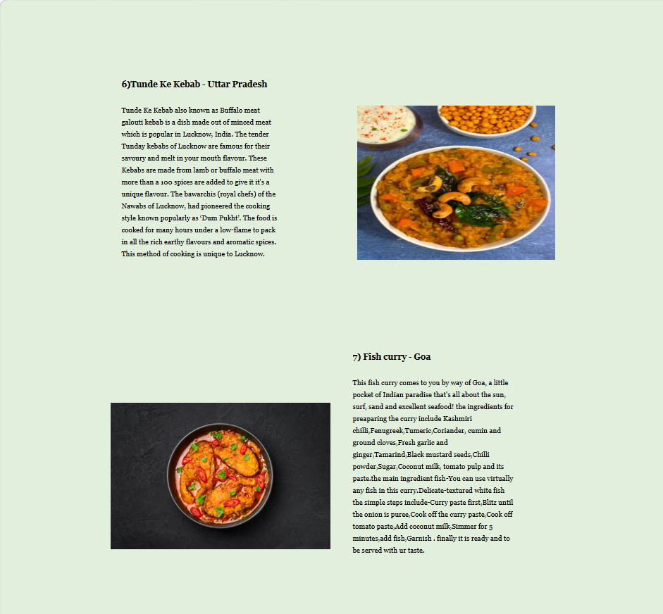
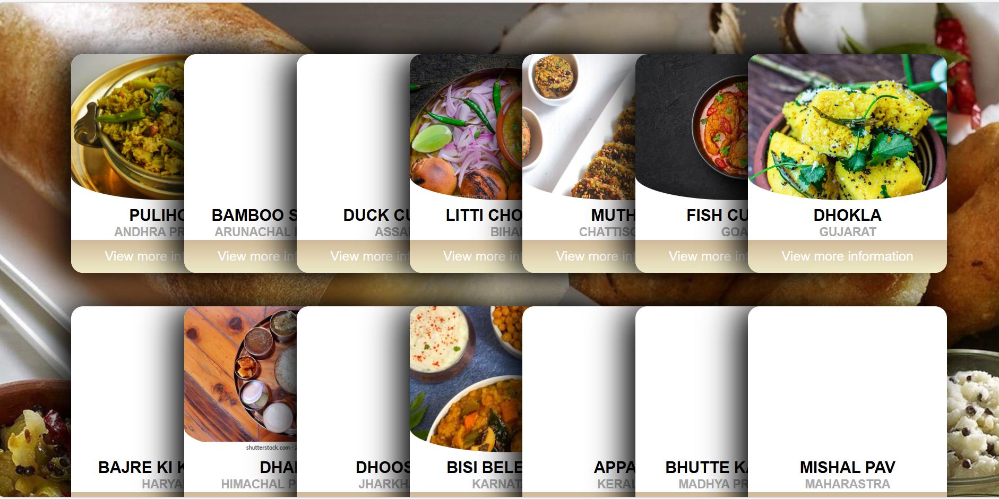

# 🍽️ Cibus — Traditional Foods Web App

> **Cibus** (Latin for *"food"*) is a static front-end web application that celebrates traditional and homestyle cuisine. It lets users explore food menus, browse recipes, add items to a cart, and sign up or log in — all through a clean and visually rich interface built with pure HTML, CSS, and JavaScript.

---

## 📸 Screenshots

| Opening Page | Food Menu | Recipe Cards |
|---|---|---|
|  |  |  |

| Add to Cart | Recipe Detail | Login |
|---|---|---|
|  |  |  |

> Screenshots are located in the [`/screenshots`](./screenshots) folder.

---

## 🚀 Features

- **Opening / Landing Page** — Animated hero section welcoming users to Cibus
- **Home Page** — Navigation hub with auto-scroll effects and dropdown menus
- **Food Menu** — Browse all available traditional food items across multiple states/regions
- **Recipe Cards** — Visual card-based layout showcasing individual recipes with images
- **Recipe Detail Page** — Full recipe view with ingredients and step-by-step instructions
- **Add to Cart** — Select food items and manage your cart with animated UI interactions
- **Login Page** — User authentication interface
- **Sign Up / Registration Form** — New user registration with email and password validation
- **Contact Page** — Contact form with input validation

---

## 🗂️ Project Structure

```
cibus/
│
├── src/                        # All source HTML and CSS files
│   ├── opening_page.html       # Landing / splash page
│   ├── home.html               # Home page with auto-scroll effect
│   ├── home.css                # Styles for home page
│   ├── food-menu.html          # Full food menu (all states/regions)
│   ├── recipe_cards.html       # Recipe cards gallery
│   ├── recipe-detail.html      # Individual recipe detail view
│   ├── add_to_cart.html        # Shopping cart page
│   ├── login.html              # Login page
│   ├── form.html               # Sign up / registration form
│   ├── form.css                # Styles for registration form
│   ├── contact.html            # Contact page
│   └── style.css               # Global stylesheet
│
├── assets/
│   ├── images/                 # Food and background images
│   ├── gif/                    # Animated GIFs used in the UI
│   └── icons/                  # Favicon and icon files
│
├── screenshots/                # App screenshots for documentation
│
├── docs/                       # Additional project documentation
│
├── .gitignore
└── README.md
```

---

## 🛠️ Tech Stack

| Technology | Usage |
|---|---|
| **HTML5** | Page structure and content |
| **CSS3** | Styling, animations, flexbox/grid layouts |
| **Vanilla JavaScript** | Form validation, cart interactions, UI effects |
| **Font Awesome** | Icons |
| **Google Fonts** | Typography (Lato, Staatliches) |

---

## ⚡ Getting Started

No installation or build tools required — this is a pure static website.

### Run Locally

1. **Clone the repository:**
   ```bash
   git clone https://github.com/your-username/cibus.git
   cd cibus
   ```

2. **Open in browser:**
   - Navigate to the `src/` folder
   - Open `opening_page.html` in any modern web browser

   Or use the VS Code Live Server extension for a better development experience:
   ```
   Right-click opening_page.html → Open with Live Server
   ```

### Recommended Entry Point

```
src/opening_page.html  →  The starting page of the app
```

---

## 📄 Pages Overview

| File | Description |
|---|---|
| `opening_page.html` | Animated landing/splash page |
| `home.html` | Main navigation hub |
| `food-menu.html` | All food items across regions |
| `recipe_cards.html` | Card gallery of recipes |
| `recipe-detail.html` | Detailed single recipe view |
| `add_to_cart.html` | Cart with animated add-to-cart buttons |
| `login.html` | User login page |
| `form.html` | User registration / sign-up |
| `contact.html` | Contact form |

---

## 📁 Additional Documentation

See the [`/docs`](./docs) folder for the full project documentation including design notes and feature descriptions.

---

## 🙌 Acknowledgements

- Food imagery sourced from open web resources
- Icons by [Font Awesome](https://fontawesome.com/)
- Fonts by [Google Fonts](https://fonts.google.com/)

---

## 📬 Contact

Have feedback or questions? Use the [Contact page](src/contact.html) within the app or open a GitHub issue.

---

*Cibus — A celebration of traditional food culture.*
