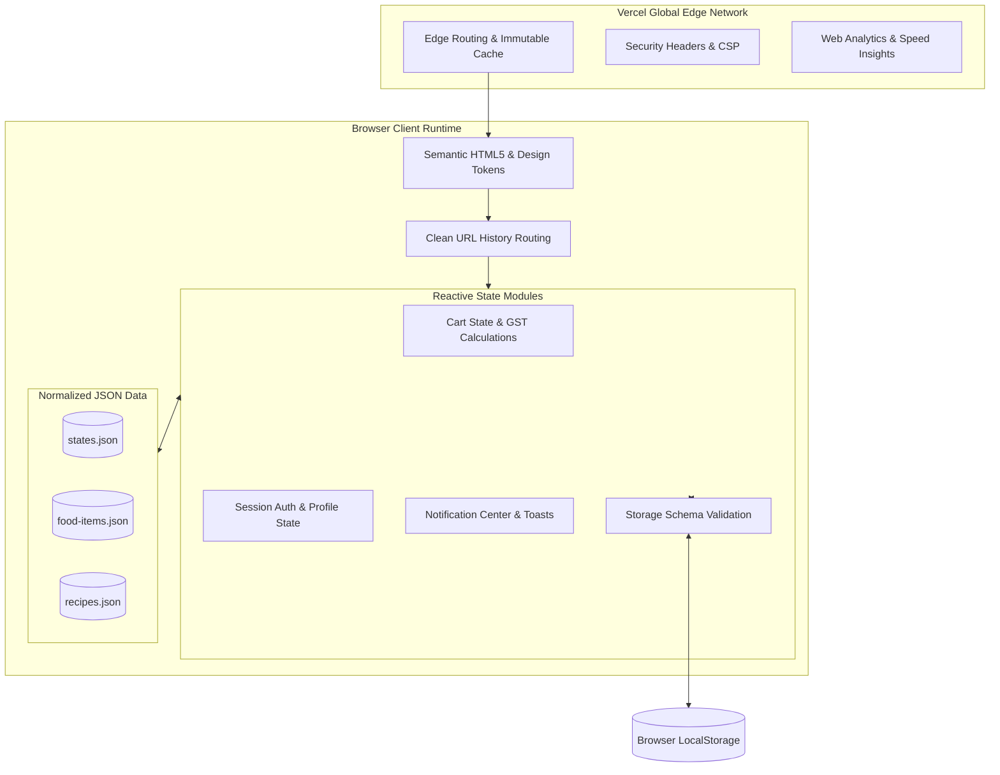

<div align="center">

# 🍲 CIBUS
### *The Living Culinary Heritage of 28 Indian States*

<p align="center">
  <b>An authentic, high-speed, culturally grounded web platform celebrating indigenous ingredients, ancestral recipes, and regional gastronomy across the length and breadth of India.</b>
</p>

[](https://github.com/GreeshmanthSaiY/cibus)
[](https://github.com/GreeshmanthSaiY/cibus)
[](https://github.com/GreeshmanthSaiY/cibus)
[](https://vercel.com)
[](./LICENSE)

<br />


<br /><br />

> *“If I were asked under what sky the human mind has most fully developed some of its choicest gifts, has most deeply pondered on the greatest problems of life, and has found solutions, I should point to India.”*  
> — **Max Müller**, Indologist & Philologist

</div>

---

## 🧭 The Problem Statement

India possesses one of the deepest, most sophisticated, and biodiverse culinary cultures on Earth. Spanning 28 states, hundreds of micro-climates, and millennia of regional agricultural traditions, each territory cultivates distinct wild herbs, ancestral grain varieties, and specialized slow-cooking techniques passed down through generations.

However, modern digital food spaces consistently fail Indian culinary heritage:

1. **Homogenization & Stereotyping:** Mainstream food media flattens Indian food into repetitive clichés—generic gravies, repetitive takeout menus, and commercial restaurant dishes. Essential regional staples—such as Tripura’s bamboo-infused *Chakhwi*, Uttarakhand’s iron-pot *Kafuli*, Himachal’s ceremonial *Dham*, or Chhattisgarh’s steamed *Muthia*—are virtually absent from mainstream culinary platforms.
2. **Inaccurate Visuals & Mismatched Dishes:** Popular cooking websites often display misleading stock photos showing unrelated curries, breads, or fast food for regional heritage dishes, diluting the authentic identity of traditional preparations.
3. **Bloated, Frustrating Interfaces:** Existing recipe websites are burdened by intrusive advertisements, tracking scripts, and multi-megabyte payloads that stutter and blur during mobile scrolling, compromising the cooking experience.
4. **Fragmented Kitchen Workflow:** Home cooks are forced to juggle static text instructions, external calculators, and separate grocery lists with no interactive way to check off ingredients in the kitchen or adjust dish portions in real time.

---

## 🌿 The Solution: CIBUS

**CIBUS** (*Latin for "Nourishment & Food"*) is an authentic, production-grade, culturally respectful digital culinary platform engineered to document, celebrate, and preserve authentic culinary traditions from all **28 States of India**.

Designed from first principles with zero external framework dependencies, CIBUS delivers a responsive 60fps experience that combines cultural storytelling, step-by-step kitchen guides, portion planning, and living spice botanical histories.

```
       🇮🇳 28 INDIAN STATES · COMPREHENSIVE REGIONAL DIVERSITY
   ┌─────────────────────────────────────────────────────────────┐
   │  🌴 SOUTH      │ Andhra · Karnataka · Kerala · Tamil · Tel  │
   │  🏔️ NORTH      │ Haryana · HP · Punjab · Rajasthan · UP · UK │
   │  🌊 WEST       │ Goa · Gujarat · Maharashtra                │
   │  🌾 EAST       │ Bihar · Jharkhand · Odisha · West Bengal   │
   │  🎋 NORTHEAST  │ Arunachal · Assam · Manipur · Meghalaya ·  │
   │                │ Mizoram · Nagaland · Sikkim · Tripura      │
   │  🌿 CENTRAL    │ Chhattisgarh · Madhya Pradesh              │
   └─────────────────────────────────────────────────────────────┘
```

---

## 🏛️ System & Engineering Architecture

CIBUS is engineered around a zero-dependency static JAMstack architecture, eliminating compilation overhead, runtime vulnerabilities, and hydration mismatches:



### Key Architectural Pillars
- **Zero Framework Bloat:** Implemented strictly with standard HTML5, CSS3 Custom Properties, and modern ECMAScript (ES6+), resulting in instantaneous first paint and zero runtime compilation overhead.
- **Normalized Data Architecture:** 28 states, dishes, and recipes are stored in three relational JSON datasets with automated schema and cross-referencing validation.
- **Fail-Safe Edge Caching:** Static assets are served with immutable 1-year cache headers (`max-age=31536000, immutable`), while structured data benefits from stale-while-revalidate caching.
- **Defensive Client Storage:** Browser storage writes and reads are passed through strict schema-enforcing type guards to eliminate data poisoning and state corruption.

---

## 📸 Product Visual Showcase

<div align="center">

### Experience Tour Across Key Product Views

| Gateway & Splash | Regional Food Discovery | Cascading Recipe Deck |
| :---: | :---: | :---: |
|  |  |  |
| *Tricolor Gateway with Ashoka Chakra* | *28-State Filter & Real-Time Search* | *Interactive 3D Cascading Recipe Cards* |

<br/>

| Living Recipe Instructions | Shopping Cart & Portioning | Session Authentication |
| :---: | :---: | :---: |
|  |  |  |
| *Interactive Ingredient Checklists* | *Portion Steppers & Live Order Summary* | *Browser-Scoped Session Security* |

</div>

---

## ✨ Core Product Features & Capabilities

### 1. 🍛 28-State Heritage Food Directory
* **Comprehensive Cultural Coverage:** Discover signature traditional dishes representing every Indian state, with authentic local names, historical contexts, and regional classifications.
* **Instant Multi-Filter Engine:** Filter instantaneously by region (*South, North, West, East, Central, Northeast*) and dietary preference (*Vegetarian, Vegan, Non-Vegetarian*).
* **Instant Typeahead Search:** Find dishes immediately by dish name, state, key spices, or culinary category.

### 2. 🎴 Dual-View Recipe Exploration Deck
* **3D Cascading Gallery:** Explore recipes in an interactive stacked deck format with depth shadows, regional accents, and dish metadata.
* **Responsive Grid Mode:** Toggle between an expansive visual grid and focused fanned cards with one click.
* **Clean Dish Identity:** Uncluttered presentation showcasing authentic culinary names with preparation timelines and portion indicators.

### 3. 📜 Living Kitchen Guide & Cooking Checklists
* **Interactive Ingredient Checklists:** Home cooks can tap and check off ingredients as they prepare, keeping active count of remaining items directly in the kitchen.
* **Step-by-Step Numbered Guidance:** Ancestral preparation methods, slow-simmering *dum* timings, stone-ground paste techniques, and tempering secrets organized sequentially.
* **Sticky Navigation Sidebar:** Jump instantly between states and recipes without losing your active step in the kitchen.

### 4. 🛒 Dynamic Cart & Portion Engine with Celebration FX
* **Adaptive Card Steppers:** Added items dynamically transform from "Add to Cart" into an active quantity stepper:
  $$\mathbf{[\,−\,]}\;\;✓\text{ In Cart (qty)}\;\;\mathbf{[\,+\,]}$$
* **Celebration Micro-Animations:** Radial bursts of saffron and gold culinary particles and a flying dish indicator each time a recipe is added to your order.
* **Real-Time Tax & Portion Mathematics:** Transparent price calculations, complimentary heritage packaging, and automated 5% GST tabulation.
* **Automatic Sign-Out Safeguard:** Signing out immediately purges the active cart and resets counter badges, ensuring privacy and data security.

### 5. 🔔 Real-Time Culinary Notification Center
* **Interactive Bell Dropdown:** Access real-time alerts, seasonal recipe recommendations, and order status updates from a glassmorphic notification drawer in the navigation bar.
* **Universal 10-Second Countdown:** Action toasts display an animated 10-second countdown bar that automatically pauses on hover.
* **Clean State Transitions:** Notifications and badge counts automatically clear upon sign-out, maintaining a quiet, distraction-free environment for guests.

### 6. 🌶️ Sacred Botanicals of Indian Heritage
Explore deep-dive agricultural and Ayurvedic profiles of India's 6 protected heritage botanicals:
* **Kashmiri Mongra Saffron** *(Pampore, Kashmir)* — Prized for intense crimson stigma and royal aroma.
* **Tellicherry Black Pepper** *(Malabar Coast, Kerala)* — Sun-ripened berries offering citrus undertones and robust warmth.
* **Guntur Sannam Chilli** *(Guntur, Andhra Pradesh)* — Celebrated for its fiery capsaicin punch and deep ruby infusion.
* **Lakadong Golden Turmeric** *(Jaintia Hills, Meghalaya)* — World-renowned for the highest natural curcumin concentration (7–9%).
* **Coorg Green Cardamom** *(Western Ghats, Karnataka)* — Fragrant sweet eucalyptus notes cultivated in misty rainforest shade.
* **Naga King Chilli (Bhut Jolokia)** *(Nagaland & Assam)* — Smoked over tribal wood fires for intense mountainous heat.

### 7. ⚡ Ultra-Fast 60fps Visual Engine
* **High-Efficiency Imagery:** All dish photographs and visuals are optimized for fast transmission and rapid browser decoding.
* **Zero Layout Shift (CLS):** Explicit aspect-ratio containers and image dimensions prevent layout jumps during loading.
* **Hardware-Accelerated Rendering:** CSS transforms and asynchronous image decoding ensure smooth scrolling across mobile and desktop devices.

---

## 🍽️ The 28-State Culinary Mosaic

| Region | State | Signature Dish | Category | Estimated Time | Price (INR) |
| :--- | :--- | :--- | :--- | :--- | :--- |
| **South** | Andhra Pradesh | **Pulihora** | Vegetarian | 35 mins | ₹160 |
| **Northeast** | Arunachal Pradesh | **Bamboo Shoot Stir Fry** | Vegan | 30 mins | ₹190 |
| **Northeast** | Assam | **Duck Meat Curry** | Non-Vegetarian | 60 mins | ₹380 |
| **East** | Bihar | **Litti Chokha** | Vegetarian | 50 mins | ₹180 |
| **Central** | Chhattisgarh | **Muthia** | Vegetarian | 30 mins | ₹150 |
| **West** | Goa | **Goan Fish Curry** | Non-Vegetarian | 40 mins | ₹360 |
| **West** | Gujarat | **Khaman Dhokla** | Vegetarian | 25 mins | ₹140 |
| **North** | Haryana | **Bajra Khichdi** | Vegetarian | 45 mins | ₹170 |
| **North** | Himachal Pradesh | **Dham (Madra)** | Vegetarian | 55 mins | ₹220 |
| **East** | Jharkhand | **Dhooska** | Vegetarian | 35 mins | ₹140 |
| **South** | Karnataka | **Bisi Bele Bath** | Vegetarian | 45 mins | ₹180 |
| **South** | Kerala | **Appam with Stew** | Vegetarian | 40 mins | ₹200 |
| **Central** | Madhya Pradesh | **Bhutte Ka Kees** | Vegetarian | 30 mins | ₹160 |
| **West** | Maharashtra | **Misal Pav** | Vegetarian | 35 mins | ₹150 |
| **Northeast** | Manipur | **Kangshoi** | Vegetarian | 30 mins | ₹170 |
| **Northeast** | Meghalaya | **Jadoh** | Non-Vegetarian | 50 mins | ₹280 |
| **Northeast** | Mizoram | **Misa Mach Poora** | Non-Vegetarian | 40 mins | ₹340 |
| **Northeast** | Nagaland | **Smoked Pork with Bamboo** | Non-Vegetarian | 60 mins | ₹390 |
| **East** | Odisha | **Chhena Poda** | Vegetarian | 50 mins | ₹190 |
| **North** | Punjab | **Makki di Roti & Sarson Saag**| Vegetarian | 55 mins | ₹240 |
| **North** | Rajasthan | **Dal Baati Churma** | Vegetarian | 65 mins | ₹260 |
| **Northeast** | Sikkim | **Steamed Momos** | Vegetarian | 35 mins | ₹180 |
| **South** | Tamil Nadu | **Masala Dosa** | Vegetarian | 30 mins | ₹150 |
| **South** | Telangana | **Hyderabadi Dum Biryani** | Non-Vegetarian | 70 mins | ₹320 |
| **Northeast** | Tripura | **Chakhwi** | Vegetarian | 35 mins | ₹160 |
| **North** | Uttar Pradesh | **Galouti Kebab** | Non-Vegetarian | 45 mins | ₹310 |
| **North** | Uttarakhand | **Kafuli** | Vegetarian | 35 mins | ₹170 |
| **East** | West Bengal | **Macher Jhol** | Non-Vegetarian | 40 mins | ₹290 |

---

## 🛡️ Application Security & Defensive Engineering

Security is built into CIBUS as an architectural foundation:

1. **Content Security Policy (CSP):** Rigorous, verified CSP declared in `vercel.json` and mirrored in the local development server:
   ```text
   default-src 'self'; script-src 'self' 'unsafe-inline' https://kit.fontawesome.com https://ka-f.fontawesome.com https://va.vercel-scripts.com https://speed-insights.vercel-scripts.com; style-src 'self' 'unsafe-inline' https://fonts.googleapis.com https://use.fontawesome.com; font-src 'self' https://fonts.gstatic.com https://ka-f.fontawesome.com data:; img-src 'self' data: https:; connect-src 'self' https://ka-f.fontawesome.com https://vitals.vercel-insights.com https://va.vercel-scripts.com; frame-ancestors 'none'; object-src 'none'; base-uri 'self';
   ```
2. **Untrusted DOM Sanitization:** Textual data is rendered via `textContent` or filtered through `Utils.escapeHtml()` to eliminate Cross-Site Scripting (XSS).
3. **Storage Defensive Validation:** LocalStorage entries are validated against strict JSON schemas before parsing, protecting against client-side state manipulation.
4. **Honest Authentication Boundaries:** Demonstrates client authentication state without false claims of cryptographic backend security.

---

## 🚀 Quick Start & Local Development

### Prerequisites
- Node.js v20.x LTS or higher (aligned with `.nvmrc`)
- Modern web browser

```bash
# 1. Clone repository
git clone https://github.com/GreeshmanthSaiY/cibus.git
cd cibus

# 2. Verify and launch development server with live reload
npm start
# Server listens on http://localhost:3000
```

### Quality Assurance & Validation Commands

```bash
# Run unit tests (22 tests across auth, cart, datasets, storage, validation)
npm test

# Run HTML integrity and broken link validation (all 11 HTML pages)
npm run validate:html

# Run server route probe (37 HTTP endpoints)
npm run test:probe

# Run production build verification gate
npm run build
```

---

## 📚 Technical Documentation Library

Deep dive into the architectural and engineering documentation available in the `docs/` directory:

- 🏛️ **[System Architecture Specification](docs/architecture/ARCHITECTURE.md)**
- 📊 **[Data Architecture & Schemas](docs/architecture/DATA_ARCHITECTURE.md)**
- 🚀 **[Vercel Production Deployment Manual](docs/deployment/VERCEL_DEPLOYMENT.md)**
- 🚢 **[Release Engineering & Branch Protection](docs/deployment/DEPLOYMENT_GUIDE.md)**
- 🛡️ **[Application Security Audit](docs/security/SECURITY_AUDIT.md)**
- 🔒 **[Frontend Security Guidelines](docs/security/SECURITY_GUIDELINES.md)**
- 🛠️ **[Local Developer Setup Guide](docs/development/SETUP_GUIDE.md)**
- 🧪 **[Automated Testing & QA Guide](docs/development/TESTING_GUIDE.md)**
- 📋 **[Existing Features Inventory](docs/project/EXISTING_FEATURES.md)**
- 📝 **[Project Changelog](docs/project/CHANGELOG.md)**

---

## 📜 Cultural Heritage Statement

> *CIBUS is created with profound gratitude to the generations of home cooks, grandmothers, regional farmers, and indigenous communities across India who have nurtured and preserved these culinary masterpieces for thousands of years. We honor the diversity, technique, and seasonal balance that make Indian food a living world heritage.*

---

## 📄 License & Attribution

- **Project Type:** Personal Project
- **Copyright:** &copy; 2026 [Greeshmanth Sai Y](https://github.com/GreeshmanthSaiY). All Rights Reserved.
- **License:** Proprietary / UNLICENSED (Unauthorized copying, redistribution, or commercial use is prohibited).
- **Platform:** [CIBUS on GitHub](https://github.com/GreeshmanthSaiY/cibus)

---

<div align="center">
  <sub>Handcrafted with devotion to the culinary heritage of Bharat 🇮🇳</sub>
</div>
