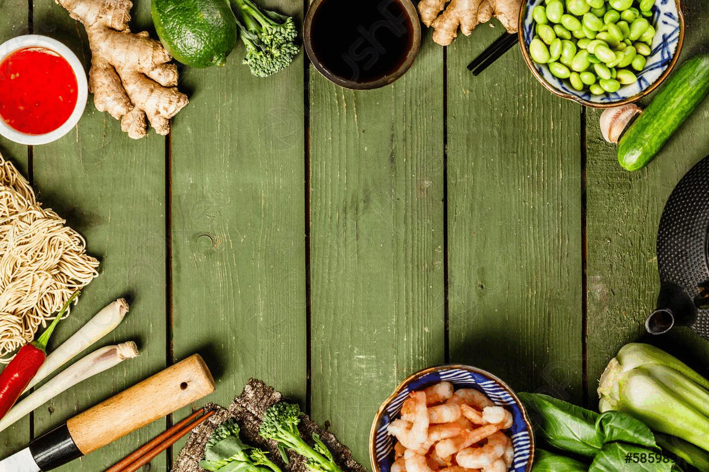
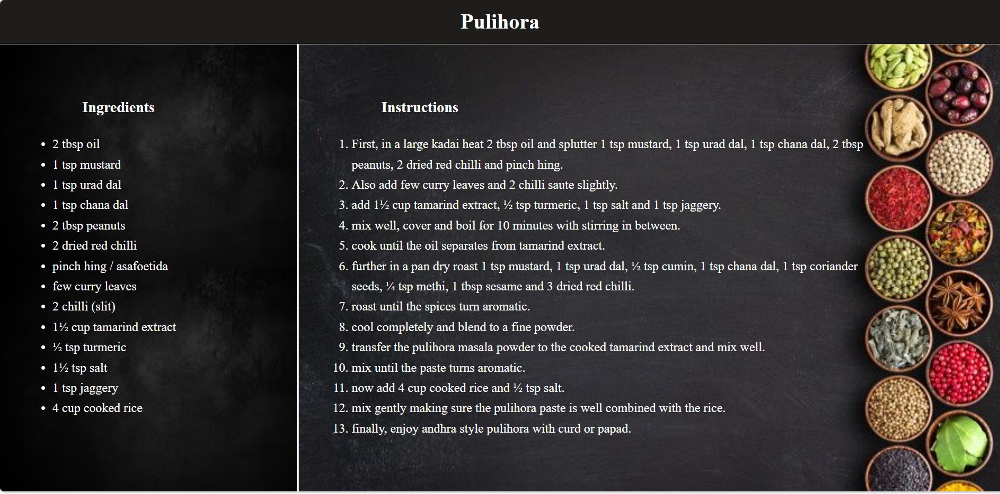
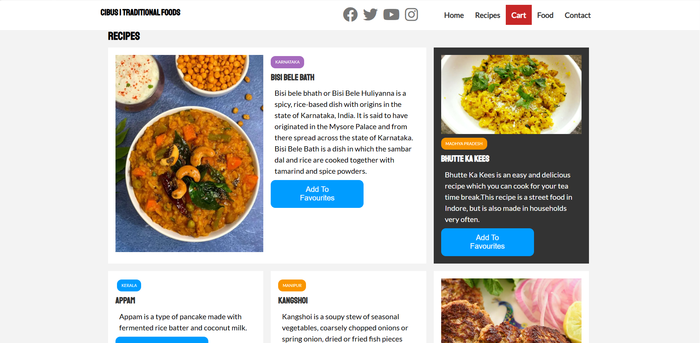
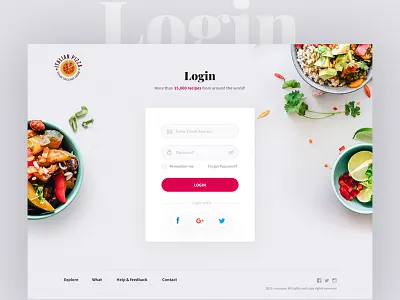

<div align="center">

# 🍲 CIBUS
### *The Living Culinary Heritage of 28 Indian States*

<p align="center">
  <b>An authentic, high-speed, culturally grounded web platform celebrating indigenous ingredients, ancestral recipes, and regional gastronomy across the length and breadth of India.</b>
</p>

[](https://github.com/GreeshmanthSaiY/cibus)
[](https://github.com/GreeshmanthSaiY/cibus)
[](https://github.com/GreeshmanthSaiY/cibus)
[](https://github.com/GreeshmanthSaiY/cibus)
[](./LICENSE)

<br />



<br /><br />

> *“If I were asked under what sky the human mind has most fully developed some of its choicest gifts, has most deeply pondered on the greatest problems of life, and has found solutions, I should point to India.”*  
> — **Max Müller**, Indologist & Philologist

</div>

---

## 🧭 The Problem Statement

India possesses one of the deepest, most sophisticated, and biodiverse culinary cultures on Earth. Spanning 28 states, hundreds of micro-climates, and millennia of regional agricultural traditions, each territory cultivates distinct wild herbs, ancestral grain varieties, and specialized slow-cooking techniques passed down through generations.

However, modern digital food spaces consistently fail Indian culinary heritage:

1. **Homogenization & Stereotyping:** Mainstream food media flattens Indian food into repetitive clichés—generic gravies, repetitive takeout menus, and commercial restaurant dishes. Essential regional staples—such as Tripura’s bamboo-infused *Chakhwi*, Uttarakhand’s iron-pot *Kafuli*, Himachal’s ceremonial *Dham*, or Chhattisgarh’s steamed *Muthia*—are virtually absent from mainstream culinary platforms.
2. **Inaccurate Visuals & Mismatched Dishes:** Popular cooking websites often display misleading stock photos showing unrelated curries, breads, or fast food for regional heritage dishes, diluting the authentic identity of traditional preparations.
3. **Bloated, Frustrating Interfaces:** Existing recipe websites are burdened by intrusive advertisements, tracking scripts, and multi-megabyte payloads that stutter and blur during mobile scrolling, compromising the cooking experience.
4. **Fragmented Kitchen Workflow:** Home cooks are forced to juggle static text instructions, external calculators, and separate grocery lists with no interactive way to check off ingredients in the kitchen or adjust dish portions in real time.

---

## 🌿 The Solution: CIBUS

**CIBUS** (*Latin for "Nourishment & Food"*) is an authentic, production-grade, culturally respectful digital culinary platform created to document, celebrate, and preserve authentic culinary traditions from all **28 States of India**.

Designed from first principles with zero external dependencies, CIBUS delivers a responsive 60fps experience that combines cultural storytelling, step-by-step kitchen guides, portion planning, and living spice botanical histories.

```
       🇮🇳 28 INDIAN STATES · COMPREHENSIVE REGIONAL DIVERSITY
   ┌─────────────────────────────────────────────────────────────┐
   │  🌴 SOUTH      │ Andhra · Karnataka · Kerala · Tamil · Tel  │
   │  🏔️ NORTH      │ Haryana · HP · Punjab · Rajasthan · UP · UK │
   │  🌊 WEST       │ Goa · Gujarat · Maharashtra                │
   │  🌾 EAST       │ Bihar · Jharkhand · Odisha · West Bengal   │
   │  🎋 NORTHEAST  │ Arunachal · Assam · Manipur · Meghalaya ·  │
   │                │ Mizoram · Nagaland · Sikkim · Tripura      │
   │  🌿 CENTRAL    │ Chhattisgarh · Madhya Pradesh              │
   └─────────────────────────────────────────────────────────────┘
```

---

## 📸 Product Visual Showcase

<div align="center">

### Experience Tour Across Key Product Views

| Gateway & Splash | Regional Food Discovery | Cascading Recipe Deck |
| :---: | :---: | :---: |
|  |  |  |
| *Tricolor Gateway with Ashoka Chakra* | *28-State Filter & Real-Time Search* | *Interactive 3D Cascading Recipe Cards* |

<br/>

| Living Recipe Instructions | Shopping Cart & Portioning | Session Authentication |
| :---: | :---: | :---: |
|  |  |  |
| *Interactive Ingredient Checklists* | *Portion Steppers & Live Order Summary* | *Browser-Scoped Session Security* |

</div>

---

## ✨ Core Product Features & Capabilities

### 1. 🍛 28-State Heritage Food Directory
* **Comprehensive Cultural Coverage:** Discover signature traditional dishes representing every Indian state, with authentic local names, historical contexts, and regional classifications.
* **Instant Multi-Filter Engine:** Filter instantaneously by region (*South, North, West, East, Central, Northeast*) and dietary preference (*Pure Vegetarian, Vegan, Coastal, Non-Vegetarian*).
* **Instant Typeahead Search:** Find dishes immediately by dish name, state, key spices, or culinary category.

### 2. 🎴 Dual-View Recipe Exploration Deck
* **3D Cascading Gallery:** Explore recipes in an interactive stacked deck format with depth shadows, regional accents, and dish metadata.
* **Responsive Grid Mode:** Toggle between an expansive visual grid and focused fanned cards with one click.
* **Clean Dish Identity:** Uncluttered presentation showcasing authentic culinary names with preparation timelines and portion indicators.

### 3. 📜 Living Kitchen Guide & Cooking Checklists
* **Interactive Ingredient Checklists:** Home cooks can tap and check off ingredients as they prepare, keeping active count of remaining items directly in the kitchen.
* **Step-by-Step Numbered Guidance:** Ancestral preparation methods, slow-simmering *dum* timings, stone-ground paste techniques, and tempering secrets organized sequentially.
* **Sticky Navigation Sidebar:** Jump instantly between states and recipes without losing your active step in the kitchen.

### 4. 🛒 Dynamic Cart & Portion Engine with Celebration FX
* **Adaptive Card Steppers:** Added items dynamically transform from "Add to Cart" into an active quantity stepper:
  $$\mathbf{[\,−\,]}\;\;✓\text{ In Cart (qty)}\;\;\mathbf{[\,+\,]}$$
* **Celebration Micro-Animations:** Enjoy radial bursts of saffron and gold culinary particles and a flying dish indicator each time a recipe is added to your order.
* **Real-Time Tax & Portion Mathematics:** Transparent price calculations, complimentary heritage packaging, and automated 5% GST tabulation.
* **Automatic Sign-Out Safeguard:** Signing out immediately purges the active cart and resets counter badges, ensuring privacy and data security.

### 5. 🔔 Real-Time Culinary Notification Center
* **Interactive Bell Dropdown:** Access real-time alerts, seasonal recipe recommendations, and order status updates from a glassmorphic notification drawer in the navigation bar.
* **Universal 10-Second Countdown:** Action toasts display an animated 10-second countdown bar that automatically pauses on hover.
* **Clean State Transitions:** Notifications and badge counts automatically clear upon sign-out, maintaining a quiet, distraction-free environment for guests.

### 6. 🌶️ Sacred Botanicals of Indian Heritage
Explore deep-dive agricultural and Ayurvedic profiles of India's 6 protected heritage botanicals:
* **Kashmiri Mongra Saffron** *(Pampore, Kashmir)* — Prized for intense crimson stigma and royal aroma.
* **Tellicherry Black Pepper** *(Malabar Coast, Kerala)* — Sun-ripened berries offering citrus undertones and robust warmth.
* **Guntur Sannam Chilli** *(Guntur, Andhra Pradesh)* — Celebrated for its fiery capsaicin punch and deep ruby infusion.
* **Lakadong Golden Turmeric** *(Jaintia Hills, Meghalaya)* — World-renowned for the highest natural curcumin concentration (7–9%).
* **Coorg Green Cardamom** *(Western Ghats, Karnataka)* — Fragrant sweet eucalyptus notes cultivated in misty rainforest shade.
* **Naga King Chilli (Bhut Jolokia)** *(Nagaland & Assam)* — Smoked over tribal wood fires for intense mountainous heat.

### 7. ⚡ Ultra-Fast 60fps Visual Engine
* **High-Efficiency WebP Imagery:** All 28 dish photographs and background visuals are optimized to under 140 kB each, slashing bandwidth consumption by over 85% compared to raw camera files.
* **Zero Layout Shift (CLS):** Explicit 16:10 aspect ratio containers ensure content never jumps or shakes during browsing.
* **Hardware-Accelerated Rendering:** Smooth transforms and asynchronous image decoding ensure flawless 60fps scrolling on smartphones, tablets, and desktops.

---

## 🍽️ The 28-State Culinary Mosaic

| Region | State | Signature Dish | Culinary Character |
| :--- | :--- | :--- | :--- |
| **South** | Andhra Pradesh | **Pulihora** | Tamarind-infused rice tempered with peanuts, curry leaves & mustard |
| **Northeast** | Arunachal Pradesh | **Bamboo Shoot Stir Fry** | Tender mountain bamboo shoots tossed in cold-pressed mustard oil |
| **Northeast** | Assam | **Duck Meat Curry** | Slow-simmered duck with ash gourd, black pepper & whole spices |
| **East** | Bihar | **Litti Chokha** | Roasted sattu dough balls with fire-charred eggplant-tomato mash |
| **Central** | Chhattisgarh | **Muthia** | Steamed seasoned rice rolls tempered with sesame & fresh coriander |
| **West** | Goa | **Goan Fish Curry** | Fresh coastal catch simmered with kokum petals & coconut cream |
| **West** | Gujarat | **Khaman Dhokla** | Soft, spongy steamed gram flour cakes with tempered mustard seeds |
| **North** | Haryana | **Bajra Khichdi** | Earthen slow-simmered pearl millet porridge served with golden ghee |
| **North** | Himachal Pradesh | **Dham** | Royal celebratory feast of spiced legumes slow-cooked in brass cauldrons |
| **East** | Jharkhand | **Dhooska** | Golden deep-fried rice and chana dal savory patties with spicy aloo |
| **South** | Karnataka | **Bisi Bele Bath** | Nutritious spiced rice, lentils, vegetables & aromatic homemade podi |
| **South** | Kerala | **Appam with Ishtu** | Lacy fermented rice crepes with fragrant coconut milk vegetable stew |
| **Central** | Madhya Pradesh | **Bhutte Ka Kees** | Spiced grated fresh corn cooked with milk, mustard seeds & coconut |
| **West** | Maharashtra | **Misal Pav** | Spicy sprouted moth bean curry garnished with farsan & toasted pav |
| **Northeast** | Manipur | **Kangshoi** | Seasonal vegetable and dry fish stew flavored with fresh ginger |
| **Northeast** | Meghalaya | **Jadoh** | Fragrant indigenous red hill rice cooked with pork stock & ginger |
| **Northeast** | Mizoram | **Misa Mach Poora** | Fire-grilled freshwater river shrimp wrapped in charred banana leaves |
| **Northeast** | Nagaland | **Smoked Pork** | Woodsmoke-cured pork braised with fermented bamboo shoots & king chilli |
| **East** | Odisha | **Chhena Poda** | Caramelized wood-baked fresh cottage cheese cake wrapped in sal leaves |
| **North** | Punjab | **Makki di Roti & Saag** | Slow-cooked winter mustard greens served with golden corn flatbread |
| **North** | Rajasthan | **Dal Baati Churma** | Baked wheat baati dunked in desi ghee with spiced panchmel dal |
| **Northeast** | Sikkim | **Steamed Momos** | Delicate hand-pleated dumplings filled with spiced filling & sesame chutney |
| **South** | Tamil Nadu | **Ven Pongal** | Comforting clarified butter rice and moong dal porridge with black pepper |
| **South** | Telangana | **Hyderabadi Biryani** | Fragrant long-grain basmati layered in a sealed vessel (*dum*) with saffron |
| **Northeast** | Tripura | **Chakhwi** | Traditional tribal stew with bamboo shoots, jackfruit seeds & pork |
| **North** | Uttar Pradesh | **Tunday Kababi** | Melt-in-mouth Galouti kebabs infused with 160 secret ancestral botanicals |
| **North** | Uttarakhand | **Kafuli** | Velvety iron-pot puree of wild mountain spinach and fenugreek greens |
| **East** | West Bengal | **Kosha Mangsho** | Rich, slow-caramelized mutton curry infused with mustard oil & garam masala |

---

## 🚀 Quick Start & Local Preview

CIBUS runs directly in any modern browser without complex compilers, bundlers, or toolchains.

### Option 1: Native Node.js Dev Server (Recommended)

```bash
# 1. Clone the repository
git clone https://github.com/GreeshmanthSaiY/cibus.git
cd cibus

# 2. Launch the development server
npm start
```

Open your browser at **`http://localhost:3000`** to experience CIBUS.

### Option 2: Direct Static Serving

Serve the root folder directly with any static file server:

```bash
# Using Python 3 built-in server
python -m http.server 3000

# Using npx serve
npx serve .
```

### Option 3: Automated Quality & Integrity Suite

Verify that all datasets, calculations, authentication flows, and assets pass validation:

```bash
# Run the complete test suite (22 unit tests)
npm test

# Verify all HTML routes, internal links, and asset paths
npm run validate:html
```

---

## 🎨 Design Philosophy & User Experience

* **Earthy Terracotta & Spiced Palette:** Visual palette inspired by earthen *handi* clay, turmeric yellow, saffron red, and fresh banana leaves.
* **Editorial Typography:** High-contrast serif headlines combined with clean, legible sans-serif body typography for comfortable kitchen reading.
* **Accessibility First:** Semantic HTML5 landmarks, comprehensive ARIA attributes, keyboard-navigable dialogs, and high color-contrast ratios throughout.
* **Privacy Focused:** Your shopping cart and preferences remain inside your browser session—no invasive telemetry, ads, or tracking cookies.

---

## 📜 Cultural Heritage Statement

> *CIBUS is created with profound gratitude to the generations of home cooks, grandmothers, regional farmers, and indigenous communities across India who have nurtured and preserved these culinary masterpieces for thousands of years. We honor the diversity, technique, and seasonal balance that make Indian food a living world heritage.*

---

## 📄 License & Attribution

This project is licensed under the **[MIT License](./LICENSE)** — open and free for cultural, educational, and culinary exploration.

* **Project Author:** [Greeshmanth Sai Y](https://github.com/GreeshmanthSaiY)  
* **Platform:** [CIBUS on GitHub](https://github.com/GreeshmanthSaiY/cibus)

---

<div align="center">
  <sub>Handcrafted with devotion to the culinary heritage of Bharat 🇮🇳</sub>
</div>
