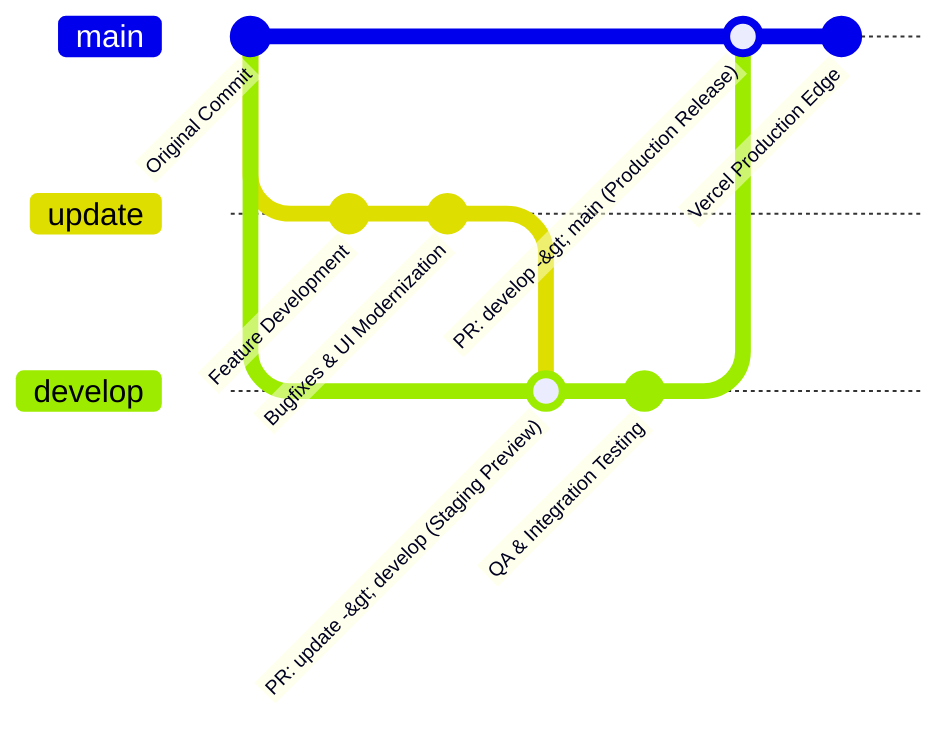

# CIBUS — VERCEL DEPLOYMENT & GITHUB REPOSITORY WORKFLOW GUIDE

- **Version:** 1.0.0
- **Auditor:** DevOps Engineer & Release Manager
- **Target Platform:** Vercel Static Hosting & GitHub Enterprise/Free

---

## 1. Overview & Branching Governance

CIBUS enforces an enterprise 3-branch Git lifecycle:



### Branch Responsibilities
1. **`update` (Active Development):**
   - All feature implementation, bug fixes, refactoring, and UI enhancements occur here.
   - Pushes trigger the `.github/workflows/quality-checks.yml` workflow.
2. **`develop` (Integration & Preview Staging):**
   - Merged exclusively via Pull Request from `update`.
   - Connected to Vercel Preview Deployments for staging verification.
3. **`main` (Production Releases):**
   - Merged exclusively via Pull Request from `develop` by repository owner `@GreeshmanthSaiY`.
   - Never modified directly. Force pushes and branch deletion are permanently blocked.
   - Connected to Vercel Production Environment.

---

## 2. GitHub Repository Configuration & Branch Protection

### Step 1: Push All Established Branches to GitHub
Run the following commands from your local repository:
```bash
# Push update branch
git push origin update

# Push develop branch
git push origin develop
```

### Step 2: Configure GitHub Branch Protection Rules
Navigate to **GitHub Repository ➔ Settings ➔ Branches ➔ Add branch ruleset** (or Branch protection rule) for `main`:
1. **Branch name pattern:** `main`
2. **Protect matching branches:**
   - [x] **Require a pull request before merging:**
     - Require approvals: `1`
     - Dismiss stale pull request approvals when new commits are pushed: `Checked`
   - [x] **Require status checks to pass before merging:**
     - Require branches to be up to date before merging: `Checked`
     - Status checks to enforce: `Code Quality & Linting`, `HTML & Integrity Validation`, `E2E Browser Tests`
   - [x] **Require conversation resolution before merging:** `Checked`
   - [x] **Do not allow bypassing the above settings:** `Checked`
   - [x] **Restrict who can push to matching branches:** Restrict to `@GreeshmanthSaiY`
   - [x] **Block force pushes:** `Checked`
   - [x] **Block deletions:** `Checked`

Configure a similar protection rule for `develop` requiring Pull Requests and passing status checks from `update`.

---

## 3. Step-by-Step Vercel Production Deployment

### Step 1: Connect GitHub Repository to Vercel
1. Log in to your [Vercel Dashboard](https://vercel.com).
2. Click **Add New... ➔ Project**.
3. Import your GitHub repository: `GreeshmanthSaiY/cibus`.

### Step 2: Project Build & Output Settings
In the Vercel project configuration screen:
- **Framework Preset:** `Other` (Static Website)
- **Root Directory:** `./` (Repository Root)
- **Build Command:** Leave blank or `npm run build` (Static validation check)
- **Output Directory:** Leave blank (Root `./` serves directly)
- **Install Command:** `npm install` (Installs lightweight test and validation tools)

### Step 3: Production and Preview Branch Mapping
In Vercel **Settings ➔ Git**:
- **Production Branch:** `main` (Only commits merged into `main` trigger live production deployments).
- **Preview Branches:** `develop` and `update` automatically generate unique preview URLs for every pull request and push.

### Step 4: Environment Variables (Optional)
If connecting optional services (e.g. Google Analytics or Sentry), add them under **Settings ➔ Environment Variables**. No secrets are required for standard CIBUS operations.

---

## 4. Local Testing & Verification Workflow

Before opening a pull request to `develop` or releasing to `main`, run:
```bash
# 1. Install development dependencies
npm install

# 2. Run code style & linting
npm run lint

# 3. Validate HTML structure & internal links
npm run validate:html

# 4. Run automated unit & integration tests
npm test

# 5. Run end-to-end browser tests
npm run test:e2e

# 6. Start local static server
npm start
```
Open `http://localhost:3000` to verify live interactions.

---

## 5. Rollback Procedures

If an issue ever occurs in production:
1. **Instant Vercel Rollback:**
   - In the Vercel Dashboard, go to **Deployments**.
   - Find the previous known-good deployment SHA.
   - Click the three dots `...` ➔ **Promote to Production**. This instantly reverts live traffic in < 2 seconds.
2. **Git Rollback:**
   ```bash
   git checkout main
   git revert HEAD -m 1
   git push origin main
   ```
3. **Restoration from Independent Complete Backup:**
   ```powershell
   # Restore raw files from verified backup
   Expand-Archive -Path backup\BACKUP_COMPLETE\cibus_original_archive.zip -DestinationPath . -Force
   ```
