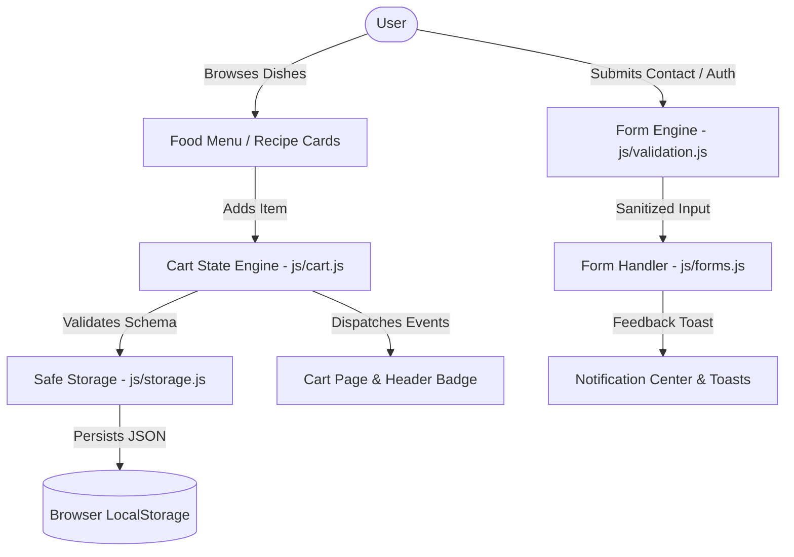

# CIBUS — Architectural Design Specification

- **Version:** 2.0.0
- **Architect:** Principal Software Architect
- **Status:** Approved Production Architecture
- **Ownership:** Personal Project &copy; 2026 Greeshmanth Sai Y. All Rights Reserved.

---

## 1. Architectural Philosophy

CIBUS is engineered as a high-performance, modular, zero-dependency static web application celebrating traditional Indian cuisine across all 28 states. It delivers a fast, responsive, and secure experience without the unnecessary overhead, hydration delays, and build fragility of heavy JavaScript frameworks.

The architecture emphasizes:
1. **Semantic HTML5:** Native accessible markup, correct landmark structures, microdata attributes, and standard form controls.
2. **Modular CSS3:** Custom properties design system (design tokens), flexbox/CSS grid layouts, zero CSS framework bloat, and `prefers-reduced-motion` compliance.
3. **Pure Vanilla Modern JavaScript (ES6+):** Pure functions, encapsulated state modules (Cart, Navigation, Search/Filter, Storage, Auth), declarative DOM bindings, and strict DOM sanitization.
4. **Resilient Local & CDN Pathing:** Universal relative paths enabling identical execution in local development, preview deployments, and production Vercel environments.
5. **Security in Depth:** Rigid Content Security Policy (CSP), subresource integrity, XSS immunity, and safe state persistence.

---

## 2. Directory Hierarchy

```text
cibus/
├── index.html                  # Root landing & splash entrypoint
├── 404.html                    # Root 404 error fallback for Vercel
├── .gitignore                  # Git tracking rules
├── .editorconfig               # Consistent cross-platform indentation & formatting
├── .npmrc                      # Package manager configuration
├── .nvmrc                      # Node.js 20 LTS runtime standard
├── package.json                # Project scripts, dev dependencies, test tooling
├── package-lock.json           # Locked dependency tree
├── vercel.json                 # Vercel deployment routing, security headers & caching
├── README.md                   # Comprehensive project documentation & showcase
├── SECURITY.md                 # Security policies & vulnerability disclosure
├── LICENSE                     # Personal project copyright & rights reserved
│
├── public/                     # Static assets served at root
│   ├── favicon.ico             # 32x32 / multi-res application favicon
│   ├── favicon.svg             # Scalable vector favicon
│   ├── site.webmanifest        # Progressive Web App manifest
│   ├── robots.txt              # Search engine crawler policies
│   ├── sitemap.xml             # Search engine indexing map
│   └── assets/
│       ├── images/             # Official branding, logos, and culinary photography
│       │   ├── cibus-logo.png
│       │   ├── cibus-logo-header.png
│       │   ├── favicon-16x16.png
│       │   ├── favicon-32x32.png
│       │   ├── favicon-48x48.png
│       │   ├── apple-touch-icon.png
│       │   ├── android-chrome-192x192.png
│       │   ├── android-chrome-512x512.png
│       │   └── food-photo.jpeg
│       └── gif/                # Hero animations & UI micro-interactions
│           └── food-animation.gif
│
├── pages/                      # Application views & pages
│   ├── home.html               # Main culinary discovery hub
│   ├── food-menu.html          # Comprehensive 28 Indian states food directory
│   ├── recipe-cards.html       # Visual card gallery of regional recipes
│   ├── recipe-detail.html      # In-depth ingredients & preparation instructions
│   ├── cart.html               # Interactive shopping & favorites cart with drawer
│   ├── login.html              # Clean authentication interface
│   ├── register.html           # New user sign-up form with live validation
│   ├── contact.html            # Contact inquiry form with feedback states
│   └── 404.html                # Custom styled, branded fallback page
│
├── css/                        # Modular stylesheet architecture
│   ├── variables.css           # Global design tokens (colors, typography, spacing, shadows)
│   ├── reset.css               # Modern CSS reset & box-sizing normalization
│   ├── layout.css              # Universal grid, flex containers, headers & footers
│   ├── components.css          # Cards, buttons, badges, modals, drawers & toasts
│   ├── responsive.css          # Media queries across mobile, tablet, and widescreen
│   ├── main.css                # Master stylesheet importing variables & components
│   └── pages/                  # Page-specific styling rules
│       ├── landing.css         # Animated wave & hero section styles
│       ├── home.css            # Culinary showcase styles
│       ├── food-menu.css       # Menu filters & state cuisine showcases
│       ├── recipes.css         # Recipe card grids & detail instruction tables
│       ├── cart.css            # Cart summary, quantity controls, empty states
│       └── forms.css           # Unified authentication & contact form styling
│
├── js/                         # Modular client-side scripts
│   ├── config.js               # Global application constants & route definitions
│   ├── utils.js                # DOM helpers, sanitization, price formatting, toast notifications
│   ├── storage.js              # Safe LocalStorage wrapper with schema validation
│   ├── navigation.js           # Responsive mobile navigation & active link handlers
│   ├── cart.js                 # Complete cart state engine (add, remove, qty, calculations)
│   ├── food-menu.js            # State menu search, filter, and quick-add logic
│   ├── recipes.js              # Recipe card search, state filter & deep link routing
│   ├── validation.js           # Real-time form validation engine with accessible error states
│   ├── forms.js                # Contact, login & register form submit handlers
│   └── main.js                 # Application bootstrapper & global event delegation
│
├── data/                       # Structured JSON culinary datasets
│   ├── states.json             # 28 Indian States & Union Territories metadata
│   ├── food-items.json         # Traditional dishes, descriptions, prices & state tags
│   └── recipes.json            # Step-by-step cooking recipes, prep times & ingredients
│
├── docs/                       # Architectural & operational documentation
│   ├── architecture/           # System & Data Architecture specifications
│   ├── deployment/             # Vercel and production deployment manuals
│   ├── security/               # Security audits & guidelines
│   ├── development/            # Developer setup & testing guides
│   └── project/                # Feature inventory, audit logs & changelog
│
├── tests/                      # Automated quality & testing suites
│   ├── unit/                   # Unit tests (auth, cart, datasets, storage, validation)
│   └── integration/            # HTML integrity and local HTTP server probes
│
└── .github/                    # GitHub repository configurations
    ├── workflows/              # GitHub Actions CI/CD workflows
    ├── ISSUE_TEMPLATE/         # Bug report and feature request templates
    ├── PULL_REQUEST_TEMPLATE.md# Pull request template
    └── SECURITY.md             # GitHub security policy
```

---

## 3. Data Flow & Component Architecture



---

## 4. Design System Tokens (CSS Custom Properties)

```css
:root {
  /* Brand Palette - Inspired by authentic Indian spices & culinary warmth */
  --color-primary: #C74B16;          /* Deep saffron / terracotta */
  --color-primary-dark: #9A340B;     /* Roasted spice */
  --color-primary-light: #FDE8DE;    /* Warm cream */
  --color-secondary: #0A6B48;        /* Cardamom / Indian green */
  --color-secondary-dark: #064E34;   /* Deep emerald */
  --color-accent: #E68A00;           /* Golden turmeric */
  --color-accent-light: #FFF4D9;     /* Saffron tint */

  /* Neutral Surface Palette */
  --color-surface-bg: #FAF7F2;       /* Warm linen backdrop */
  --color-surface-card: #FFFFFF;     /* Crisp card surface */
  --color-surface-elevated: #F4EFEA; /* Subtle container wash */
  --color-text-main: #1C1917;        /* Charcoal ink */
  --color-text-muted: #645D56;       /* Stone grey */
  --color-border: #E7DFD5;           /* Soft border separator */

  /* Status Tokens */
  --color-success: #15803D;
  --color-error: #B91C1C;
  --color-warning: #B45309;

  /* Typography Scale */
  --font-heading: 'Playfair Display', Georgia, serif;
  --font-body: 'Plus Jakarta Sans', system-ui, -apple-system, sans-serif;
  --font-mono: ui-monospace, monospace;

  /* Shadow & Elevation System */
  --shadow-sm: 0 1px 2px 0 rgba(28, 25, 23, 0.05);
  --shadow-md: 0 4px 6px -1px rgba(28, 25, 23, 0.08), 0 2px 4px -2px rgba(28, 25, 23, 0.05);
  --shadow-lg: 0 10px 15px -3px rgba(28, 25, 23, 0.1), 0 4px 6px -4px rgba(28, 25, 23, 0.05);
  --shadow-xl: 0 20px 25px -5px rgba(28, 25, 23, 0.12), 0 8px 10px -6px rgba(28, 25, 23, 0.04);
}
```

---

## 5. Deployment Architecture on Vercel

- **Hosting Provider:** Vercel Global Edge Network.
- **Zero Build Compilation:** Pure static assets served directly with instantaneous edge invalidation.
- **Root Entrypoint:** `index.html` (Landing splash with Tricolor gradient, Ashoka Chakra, and parallax waves).
- **Rewrites & Clean URLs:** Clean routes defined in `vercel.json` (`/home`, `/food-menu`, `/recipe-cards`, `/recipe-detail`, `/cart`, `/login`, `/register`, `/contact`).
- **Global Edge Caching:** Static assets (`/public/assets/*`, `/css/*`, `/js/*`) configured with immutable cache-control headers (`public, max-age=31536000, immutable`).
- **Telemetry Integration:** Non-blocking, failsafe Vercel Web Analytics & Speed Insights integration.

